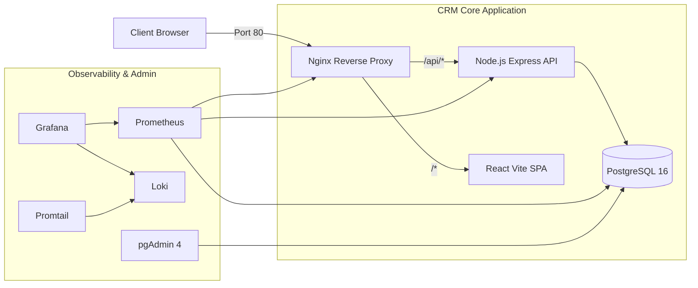

# CRM CARE – HỆ THỐNG QUẢN LÝ QUAN HỆ KHÁCH HÀNG

> **ĐỒ ÁN MÔN HỌC:** TRIỂN KHAI VÀ QUẢN TRỊ HỆ THỐNG PHẦN MỀM  
> **ĐỀ TÀI:** ĐỀ 4 – HỆ THỐNG CRM CHĂM SÓC KHÁCH HÀNG  
> **SINH VIÊN THỰC HIỆN:** dtc245200851  
> **MÃ SỐ SINH VIÊN (MSSV):** dtc245200851  
> **GITHUB REPOSITORY:** [https://github.com/dtc245200851/CRM_care_KTHP.git](https://github.com/dtc245200851/CRM_care_KTHP.git)

---

## 1. Giới thiệu Dự án

**CRM Care** là hệ thống quản lý quan hệ khách hàng toàn diện, chuyên nghiệp và sẵn sàng triển khai thực tế trên nền tảng Docker Container. Hệ thống đáp ứng đầy đủ các chức năng quản lý khách hàng doanh nghiệp, người liên hệ đại diện và theo dõi chi tiết lịch sử tương tác đa kênh (Cuộc gọi, Email, Buổi họp, Hỗ trợ kỹ thuật).

Hệ thống được thiết kế theo các tiêu chuẩn kỹ thuật cao về:
- **Kiến trúc dịch vụ phân tán:** Nginx Reverse Proxy làm cổng định tuyến duy nhất.
- **Bảo mật nhiều lớp:** Rate limiting, JWT Token, mã hóa mật khẩu Bcrypt, Non-root Docker Containers.
- **Giám sát thời gian thực:** Tích hợp Prometheus thu thập số liệu và Grafana trực quan hóa.
- **Quản trị nhật ký tập trung:** Loki & Promtail thu thập log hệ thống và ứng dụng.

---

## 2. Công nghệ Sử dụng

| Thành phần | Công nghệ chính | Vai trò |
| :--- | :--- | :--- |
| **Frontend** | React 18, TypeScript, Vite, Tailwind CSS, Lucide Icons, Recharts | Giao diện Single Page Application hiện đại, trực quan |
| **Backend** | Node.js, Express.js, TypeScript, Prisma ORM, Zod, Pino | RESTful API Server, xử lý nghiệp vụ, logging & metrics |
| **Database** | PostgreSQL 16 (Alpine) | Cơ sở dữ liệu quan hệ lưu trữ thông tin nghiệp vụ |
| **DB Admin** | pgAdmin 4 | Giao diện quản trị, backup & restore database trên nền web |
| **Reverse Proxy** | Nginx 1.25 (Alpine) | Cổng tiếp nhận duy nhất, cân bằng tải, bảo mật, Gzip |
| **Monitoring** | Prometheus v2.51.0, Grafana 10.4.0 | Thu thập số liệu, cảnh báo và bảng điều khiển giám sát |
| **Exporters** | Postgres Exporter, Nginx Exporter, Node Exporter | Thu thập chỉ số kỹ thuật từ các dịch vụ |
| **Logging** | Grafana Loki v3.0.0, Promtail v3.0.0 | Thu thập, nén và truy vấn nhật ký tập trung |
| **Containerization** | Docker & Docker Compose | Đóng gói và triển khai đồng bộ tất cả các dịch vụ |

---

## 3. Kiến trúc Hệ thống



---

## 4. Danh sách Cổng Dịch vụ và Tài khoản Mặc định

| Dịch vụ | URL Truy cập | Tài khoản / Mật khẩu |
| :--- | :--- | :--- |
| **Ứng dụng CRM Care** | [http://localhost](http://localhost) | `admin@crmcare.local` / `Admin@CRM2024!`<br>`manager@crmcare.local` / `Manager@CRM2024!`<br>`staff@crmcare.local` / `Staff@CRM2024!` |
| **pgAdmin 4** | [http://localhost:5051](http://localhost:5051) | `admin@crmcare.local` / `PgAdm1n@SecureP@ss2024!` |
| **Grafana Dashboard** | [http://localhost:3000](http://localhost:3000) | `admin` / `Gr@fana@SecureP@ss2024!` |
| **Prometheus** | [http://localhost:9091](http://localhost:9091) | Truy cập trực tiếp (Không yêu cầu mật khẩu) |
| **Loki Readiness** | [http://localhost:3101/ready](http://localhost:3101/ready) | Endpoint kiểm tra trạng thái Loki |
| **API Health Check** | [http://localhost/api/health](http://localhost/api/health) | Trạng thái Uptime và kết nối DB |
| **API Metrics** | [http://localhost/metrics](http://localhost/metrics) | Số liệu Prometheus của Backend API |

---

## 5. Hướng dẫn Khởi chạy trong 1 Câu Lệnh Duy Nhất (One-Command Startup)

Hệ thống đã được tích hợp bộ script master tự động hóa 100% mọi công đoạn: kiểm tra Docker, tự tạo `.env`, build và chạy 12 containers, tự động chờ PostgreSQL sẵn sàng, chạy migration và nạp 50 tương tác / 20 công ty / 30 liên hệ mẫu, sau đó kiểm tra sức khỏe các dịch vụ.

### Cách 1: Chạy bằng NPM (Khuyên dùng nhất trên Windows / Linux)
Chạy được ở cả thư mục `C:\TRIENKHAI_01` hoặc `C:\TRIENKHAI_01\crm-care`:
```powershell
npm start
```

### Cách 2: Chạy bằng PowerShell Script (Windows)
```powershell
.\start.ps1
```
*(Nếu Windows báo lỗi ExecutionPolicy, chạy: `powershell -ExecutionPolicy Bypass -File .\start.ps1`)*

### Cách 3: Chạy bằng Batch File (CMD hoặc Click đúp chuột trên Windows)
```cmd
.\start.bat
```
*(Hoặc click đúp chuột trực tiếp vào file `start.bat`)*

### Cách 4: Chạy bằng Bash (Linux / macOS / WSL)
```bash
chmod +x start.sh && ./start.sh
```

### Cách 4: Chạy thủ công từng bước qua Docker Compose
```bash
docker compose up -d --build
.\scripts\init-db.ps1
.\scripts\health-check.ps1
```

---

## 6. Cấu trúc Thư mục Dự án

```text
crm-care/
├── .env.example                     # Mẫu biến môi trường
├── .gitignore                       # Danh sách loại trừ Git
├── docker-compose.yml               # Docker Compose cụm CRM lõi
├── docker-compose.monitoring.yml    # Docker Compose cụm Giám sát & Logs
├── README.md                        # Hướng dẫn tổng thể đồ án
├── backend/                         # Source code Backend (Node.js + TS + Prisma)
│   ├── Dockerfile                   # Multi-stage Dockerfile cho Backend
│   ├── prisma/
│   │   ├── schema.prisma            # Schema định nghĩa CSDL
│   │   └── seed.ts                  # Dữ liệu mẫu (3 Users, 20 Customers, 30 Contacts, 50 Interactions)
│   ├── src/                         # Mã nguồn API Controllers, Routes, Middlewares
│   └── tests/                       # Unit tests xác thực và bảo mật
├── frontend/                        # Source code Frontend (React + Vite + Tailwind)
│   ├── Dockerfile                   # Multi-stage Dockerfile cho Frontend (Nginx Alpine)
│   ├── nginx.conf                   # Cấu hình Web Server tĩnh cho SPA
│   └── src/                         # Trang Dashboard, Khách hàng, Liên hệ, Tương tác
├── database/                        # Cấu hình CSDL & Thư mục sao lưu
│   ├── init/01-init.sql             # SQL Script tự động tạo extension & user giám sát
│   └── backups/                     # Nơi lưu trữ các bản backup tự động
├── nginx/                           # Cấu hình Nginx Reverse Proxy chính
│   ├── nginx.conf                   # Tinh chỉnh hiệu năng, Gzip, JSON Logging, Rate Limits
│   └── conf.d/crm-care.conf         # Cấu hình định tuyến /api, /, /metrics, /nginx_status
├── monitoring/                      # Cấu hình Prometheus & Grafana
│   ├── prometheus/prometheus.yml    # Cấu hình Scrape Targets
│   └── grafana/                     # Provisioning Datasources & Dashboards JSON
├── logging/                         # Cấu hình Loki & Promtail
│   ├── loki/loki-config.yml         # Cấu hình lưu trữ Log cục bộ
│   └── promtail/promtail-config.yml # Cấu hình quét và gửi Log từ Nginx & Backend
├── scripts/                         # Bộ công cụ tự động hóa DevOps
│   ├── init-db.ps1 / init-db.sh     # Script khởi tạo và nạp dữ liệu mẫu
│   ├── backup.ps1 / backup.sh       # Script sao lưu tự động PostgreSQL
│   ├── restore.ps1 / restore.sh     # Script phục hồi dữ liệu từ bản sao lưu
│   └── health-check.ps1 / .sh       # Script kiểm tra kết nối toàn bộ hệ thống
└── docs/                            # Tài liệu chuyên sâu đồ án
    ├── ARCHITECTURE.md              # Kiến trúc hệ thống và sơ đồ tương tác
    ├── DEPLOYMENT.md                # Hướng dẫn chi tiết vận hành & xử lý sự cố
    ├── API.md                       # Tài liệu chi tiết các endpoint RESTful
    └── MONITORING.md                # Hướng dẫn giám sát, thông số đo lường & LogQL
```

---

## 7. Lịch sử Cam kết (Commit Breakdown)

Tuân thủ đúng yêu cầu của đề tài, toàn bộ mã nguồn được cam kết và đẩy lên GitHub theo 3 giai đoạn:
1. **Commit 1: `feat: CRM Core + PostgreSQL + pgAdmin + Nginx Reverse Proxy`**
   - Mã nguồn ứng dụng CRM đầy đủ (Frontend React + Backend Express + Prisma).
   - Cơ sở dữ liệu PostgreSQL 16 và pgAdmin 4.
   - Cổng Nginx Reverse Proxy tích hợp rate limiting và bảo mật.
2. **Commit 2: `feat: Monitoring Stack - Prometheus + Grafana + Exporters`**
   - Cấu hình máy chủ Prometheus và các Exporters (Postgres, Nginx, Node).
   - Grafana với datasources và Dashboard giám sát toàn diện định sẵn.
3. **Commit 3: `feat: Logging Stack (Loki + Promtail) + Security Hardening + DevOps Scripts`**
   - Cụm thu thập nhật ký thời gian thực Loki & Promtail.
   - Bộ scripts tự động hóa sao lưu, phục hồi và kiểm tra sức khỏe.
   - Hoàn thiện tài liệu kỹ thuật toàn diện trong thư mục `docs/`.
